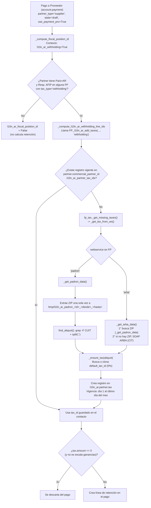

# Cómo funciona el importador de Padrón de Alícuotas (ZIP) en Odoo 18 (`l10n_ar_tax`) y resolución para ARBA / RN 42/12

> **Base de análisis:** `outsource-argentina-dimat-staging-41899251` — Odoo `18.0`, módulo `l10n_ar_tax` (`18.0.1.41.0`), compañía `[1] DROGUERIA DIMAT SA` (`CUIT 30711432031`).  
> **Archivos observados:** `res_company_jurisdiction_padron.py`, `account_fiscal_position_l10n_ar_tax.py`, `account_fiscal_position.py`, `account_payment.py`, `account_move_line.py`, `account_tax.py`, `res_company.py`, `l10n_ar_partner_tax.py`.

---

## 1. ¿Qué es "Padrón de Alícuotas por compañía" y qué hace al subir el `.zip`?

En UI se accede por **Contabilidad → Configuración → AFIP → Padrón de Alícuotas por compañía** (modelo `res.company.jurisdiction.padron`, definido en `l10n_ar_tax`).

### Datos que almacena el registro
- `company_id`: compañía a la que aplica (`DROGUERIA DIMAT SA`).
- `state_id`: provincia / jurisdicción (`base.state_ar_b` = Buenos Aires / código jurisdicción `902`, o `base.state_ar_s` = Santa Fe / código `921`). Las demás jurisdicciones devuelven `ValidationError`.
- `l10n_ar_padron_from_date` / `l10n_ar_padron_to_date`: rango de vigencia del archivo (p. ej. `2026-11-01` a `2026-11-30`).
- `file_padron` + `filename`: binario del `.zip` descargado de ARBA (`PadronRGSMMAAAA.zip`) o de API Santa Fe (`PARP_999999.zip`).

### Qué **NO** hace al guardar el archivo (comportamiento estándar)
Al cargar el `.zip` y presionar Guardar, **`l10n_ar_tax` no procesa el contenido ni carga nada en los contactos ni en `account.tax`**. Solo guarda el binario en el registro.  
El padrón recién se lee **bajo demanda (lazy lookup)** la primera vez que se calcula un pago a proveedor o una factura de venta dentro de ese período para un contacto que todavía no tiene alícuota guardada para ese mes.

---

## 2. Estructura interna real de `PadronRGS112026.zip` (ARBA)

Inspeccionando el archivo real de noviembre 2026 (`35.845.808` bytes):

- Carpeta interna: `PadronRGS112026/`
  - `PadronRGSPer112026.txt` (`310.749.096` bytes) — Percepciones.
  - `PadronRGSRet112026.TXT` (`144.796.904` bytes, `2.585.659` líneas) — Retenciones.

Cada línea de `PadronRGSRet112026.TXT` viene separada por `;` (codificación `latin-1`) con esta estructura:

```text
0 | 1        | 2        | 3        | 4           | 5 | 6 | 7 | 8    | 9  | 10
R ; 29102026 ; 01112026 ; 30112026 ; 20002592720 ; D ; N ; S ; 0,40 ; 07 ;
```

| Índice | Significado | Qué lee `l10n_ar_tax` |
|---|---|---|
| `0` | Tipo (`R` Retención / `P` Percepción) | No se filtra por columna `0`; se distingue por archivo (`Ret` vs `Per`). |
| `3` | Fecha/Nro hasta (`find_aliquot` lo devuelve como `nro` de comprobante) | Se usa como bandera booleana de *"encontrado en padrón"* (`if nro:`). |
| `4` | **CUIT** (11 dígitos sin guiones) | Comparación exacta `values[4] == cuit` tras filtrar líneas candidatas con `grep -F`. |
| `5` | Tipo contribuyente (`D` Directo, `C` Convenio Multilateral) | Informativo (`2.009.549` `D` y `576.110` `C` en 11/2026). |
| `8` | **Alícuota** con coma decimal (`0,00`, `0,40`, `1,75`, `2,50`, `6,00`) | Convierte `,` → `.` y castea a `float`. |
| `9` | Grupo de alícuota ARBA (`00` a `25`, 26 valores) | Mapeo interno ARBA de alícuota; **no** representa impuestos contables separados en Odoo. |

> **Observación sobre impuestos "nuevos" en el ZIP:** En `PadronRGSRet112026.TXT` existen `25` alícuotas únicas (`0,00%` hasta `6,00%`), y aplicando el mínimo de `2,50%` para droguerías (RN 42/12) se reducen a **`6` tasas positivas** (`2,50%`, `3,00%`, `3,50%`, `4,00%`, `5,00%`, `6,00%`) más `0,00%`. Todas usan la **misma cuenta contable (`2.1.3.02.050`), mismo grupo (`VAT Withholding`) y misma secuencia (`Ret IIBB BA`)**.

---

## 3. Circuito paso a paso: del ZIP al pago/factura y a la ficha del contacto



### Puntos clave del funcionamiento interno

1. **Extracción cacheada en `/tmp` (`_get_parp_tmp_dir`):**
   - El ZIP se extrae en `/tmp/l10n_ar_padron_<id>_<from_date>_<to_date>/` la primera vez que `find_file()` no encuentra el archivo.
   - Las consultas siguientes del mismo mes leen directamente ese directorio con `grep -F` (muy rápido, sin volver a decodificar el binario de 35 MB).
   - Un cron (`l10n_ar_tax: Clean old padron files`, inactivo en staging por defecto) elimina registros de padrón con más de 1 año de antigüedad.

2. **Creación automática de alícuotas (`_ensure_tax(rate)`):**
   - En `account.fiscal.position.l10n_ar_tax`, solo se configura **un impuesto plantilla `0%`** (`default_tax_id`), por ejemplo `[461] IIBB WTH BA 0%`.
   - Cuando el padrón devuelve una alícuota `rate` (por ej. `2.5` o `3.5`), `_ensure_tax(rate)`:
     1. Busca en `account.tax` (incluidos archivados, `active_test=False`) un impuesto de la compañía con mismo `tax_group_id`, misma provincia (`l10n_ar_state_id`), `l10n_ar_withholding_payment_type = 'supplier'` (o `type_tax_use = 'sale'` en percepciones) y `amount == rate`.
     2. Si existe archivado, lo desarchiva (`active = True`).
     3. Si no existe, **clona `default_tax_id` (`copy()`)** reemplazando el porcentaje en el nombre (ej. `IIBB WTH BA 2.5%`), heredando cuenta contable, reparticiones y secuencia de certificado.

3. **Caché mensual en el contacto (`l10n_ar.partner.tax`):**
   - Sea que el CUIT figure con tasa `> 0`, `0,00%`, o **no figure en el padrón** (`aliquot is None` → usa `default_tax_id` `0%`), `_get_tax_from_ws()` crea un registro en `l10n_ar.partner.tax` con `from_date = 1° del mes` y `to_date = último día del mes`.
   - **Propósito:** evitar volver a consultar el archivo/webservice en cada factura o pago dentro del mismo mes. En el contacto se ve en **solapa Contabilidad → Purchase Withholding (`l10n_ar_partner_tax_ids`)** o **Sale Perceptions (`l10n_ar_partner_perception_ids`)**.

4. **Por qué en Pagos solo asigna retención a proveedores:**
   - `account.payment._compute_fiscal_position_id()` exige `rec.partner_type == 'supplier'` (en cobros a clientes deja la FP en `False`).
   - `account.payment._compute_l10n_ar_withholding_line_ids()` filtra `partner_type == 'supplier'` y pide `tax_type='withholding'` a `_l10n_ar_add_taxes()`.
   - Una FP configurada solo con líneas `withholding` (sin `tax_ids`, `account_ids` ni `perception`) queda automáticamente excluida de facturas de venta/compra gracias a `exclude_withholding_only` en `_get_fpos_ranking_functions()`.

---

## 4. Bugs detectados en el `l10n_ar_tax` estándar (`18.0.1.41.0`)

Durante la auditoría en vivo (`01_entorno_y_codigo_padron.txt` y `04_simular_circuito_completo.txt`) se verificaron **3 defectos reales** en `res.company.jurisdiction.padron` que impiden usar directamente el ZIP oficial de ARBA:

1. **Bug de subcarpeta en `find_file()` + `_get_aliquot()`:**
   - `find_file()` recorre `os.walk(rootdir)` pero devuelve **únicamente el nombre del archivo (`res = f`)** sin la subcarpeta (`subdir`).
   - Luego `_get_aliquot()` hace `os.path.join(tmp_dir, path_file)`. Como `PadronRGS112026.zip` guarda los archivos dentro de `PadronRGS112026/`, apunta a `/tmp/.../PadronRGSRet112026.TXT` (inexistente) y `grep` devuelve **`(False, False, False)` para todos los contactos**.

2. **Sobrescritura de `nro` entre `Per` y `Ret` + posible `AttributeError`:**
   - `_get_aliquot()` recorre `["Per", "Ret"]` y pisa la misma variable `nro` en la segunda vuelta.
   - Si un CUIT figura solo en `Per` y falta en `Ret`, `Ret` pisa `nro = False` y anula la percepción encontrada.
   - Si figura en `Ret` y falta en `Per`, `nro` queda con valor pero `aliquot_per` queda en `False`, provocando `AttributeError: 'bool' object has no attribute 'replace'` en `_get_padron_data()` al calcular percepciones.

3. **Regex defectuoso, caché obsoleto en `/tmp` y fugas de tempfiles:**
   - `find_file()` arma `pattern = r"%s.{1}|.TXT\Z" % type_code + date` (el operador `|` sin paréntesis rompe el patrón completo).
   - Si se reemplaza el archivo en un registro existente de `res.company.jurisdiction.padron` sin cambiar fechas, el directorio `/tmp/l10n_ar_padron_<id>_...` conserva los `.TXT` viejos.
   - `descompress_file()` deja abierto un archivo temporal sin borrarlo en `/tmp`.

Además, el estándar **no implementa el piso de `2,50%` de la RN 42/12 (droguerías)**.

---

## 5. Archivo ZIP (`padron`) vs Webservice ARBA (`arba`): cuál conviene

En `l10n_ar_tax`, la opción `webservice = 'arba'` en la Posición Fiscal tiene un diseño híbrido muy práctico (`account_fiscal_position_l10n_ar_tax._get_arba_data()`):

| Aspecto | `webservice = 'padron'` (ZIP) | `webservice = 'arba'` (Webservice SOAP) |
|---|---|---|
| **Mantenimiento mensual** | Requiere descargar el ZIP (~35 MB) desde ARBA y subirlo cada mes a Odoo. | **Cero carga mensual**: consulta al vuelo el CIT de la compañía configurado en Ajustes. |
| **Contingencia** | Si no hay padrón para el mes, bloquea con `UserError`. | **Automáticamente revisa si hay un ZIP cargado primero**, y solo llama al SOAP de ARBA si no hay ZIP para ese mes. |
| **Dependencia externa** | 100% local en el servidor; instantáneo tras extraer `/tmp`. | Depende de disponibilidad de `dfe.arba.gov.ar` (timeout `15s`) y clave **CIT** configurada. |
| **Regla RN 42/12 (`2,50%`)** | Se aplica si se corrige al leer el ZIP (o al transformar el ZIP antes). | **Sin módulo custom devuelve la alícuota cruda de ARBA** (ej. `0,40%`, `1,75%`), ¡necesitaría igual nuestra lógica custom! |

**Conclusión:** con el módulo custom aplicando el mínimo configurable **sobre la salida de ambos métodos (`_get_padron_data` y `_get_arba_data`)** y un selector en Ajustes (`padron` vs `arba`), hoy pueden operar con el ZIP de forma inmediata (sin esperar la clave CIT ni depender del WS) y el día de mañana cambiar a Webservice ARBA con **un solo clic**, manteniendo exactamente el piso del `2,50%`.
